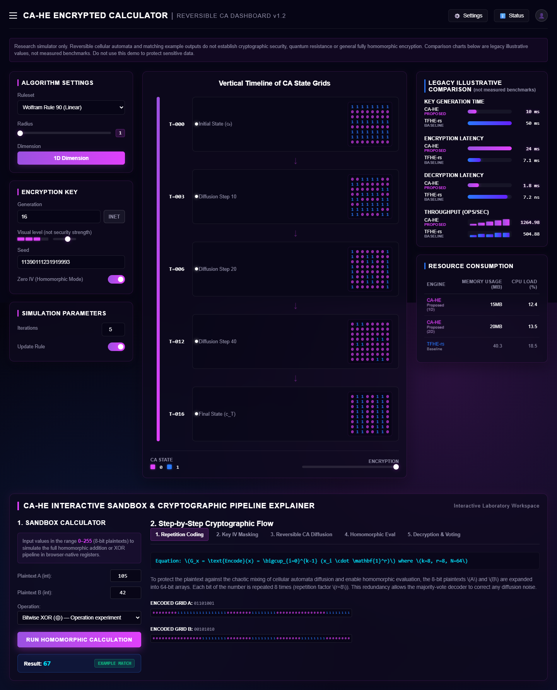
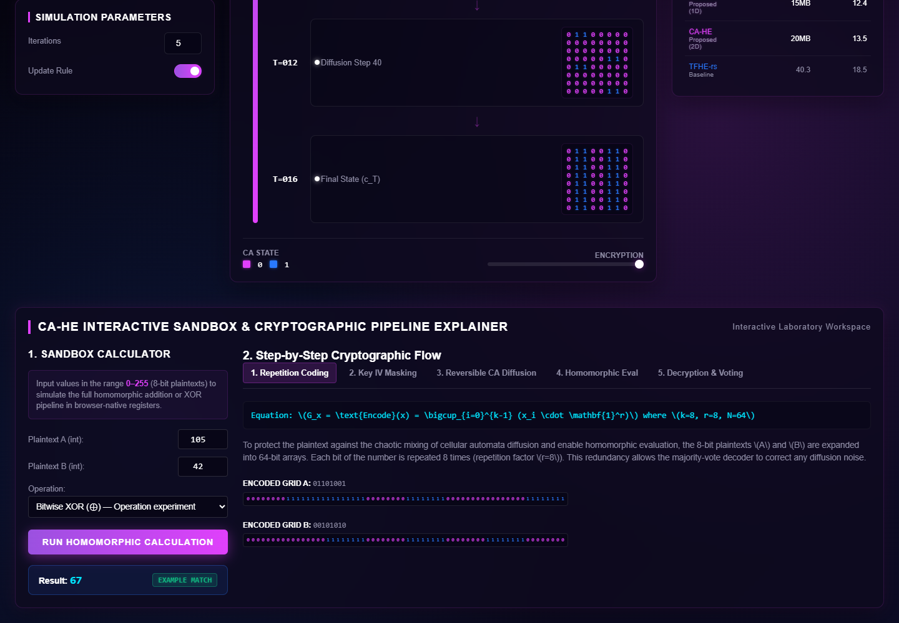
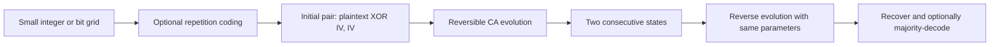

# CA-HE: reversible cellular-automata experiments

A research and learning repository exploring reversible cellular automata, repetition coding and selected operations on transformed bit grids. It includes a Rust core, Python reference implementation and native bindings, search programs, a browser simulator and an experimental Solidity rule registry.

**This is not validated encryption, a demonstrated replacement for TFHE, or an established post-quantum system. Do not use it to protect sensitive data.** Reversible computation and successful arithmetic examples do not prove confidentiality, integrity or general fully homomorphic encryption.

## Actual simulator





Captured from the local application in Edge at 1440 × 1000 with external requests blocked. The example uses 1D Rule 90, radius 1, 16 evolution steps and zero IV. The comparison charts and resource numbers are fixed legacy illustrations, not measured telemetry or a TFHE benchmark. The simulator is JavaScript; it does not call the Rust library. An **EXAMPLE MATCH** badge compares that one output with ordinary arithmetic.

## What is implemented



The second-order update is `next = local_rule(current) XOR previous`. The reference implementation packs a 1D grid into a Python integer. Rust supports 1D, 2D and 3D grids and exports a C ABI loaded by Python's `ctypes`.

For 1D Rule 90 at radius 1, the transform is linear: XOR of two ciphertext pairs already represents the XOR input at the same evolution time. The repaired browser and native evaluation paths avoid evolving that pair a second time. Decrypt combined ciphertexts with the combined IV (`IV_A XOR IV_B`, zero for equal IVs). This is an algebraic property of the selected transform, not a security guarantee. General nonlinear, AND, OR and integer-addition correctness is not established.

## Build and check the core

Install a Rust toolchain and Python 3.9+ (the reference uses modern built-in generic annotations). Windows also needs the linker/build tools required by the selected Rust target. From the repository root:

```sh
cargo check --manifest-path rust/Cargo.toml
cargo test --manifest-path rust/Cargo.toml
cargo build --manifest-path rust/Cargo.toml
python -m unittest discover -s tests -v
```

The native build is required before importing `src/cahe_bindings.py`. The loader searches `rust/target/release`, `rust/target/debug`, the source/current directory, and system library paths for the platform's library. `cargo build --release --manifest-path rust/Cargo.toml` creates an optimized build if needed; no release-mode timing is claimed here.

Verification on Windows, 9 November 2026:

- Eight existing Rust tests passed, covering shifts, roundtrips, repetition coding and selected linear examples. Compiler warnings remain.
- Nine Python binding tests passed against the actual locally compiled library. The new Rule-90 regression has three input/step cases; all three failed before the native fix (including `0` instead of `67` for `105 XOR 42`) and passed afterward.
- A separate bounded smoke checked 240 Python-reference roundtrips across small grids, rules and step counts. It establishes those roundtrips, not cryptographic security.
- Three real-browser Rule-90 XOR cases passed after repair, with a visible research notice and no uncaught page errors. The first browser case failed before the correction.

Dependencies were resolved from the existing local Cargo cache with `--offline`. Cargo.lock is currently ignored, so dependency versions are not fixed by a committed lockfile. Search-program binaries compiled as part of the checks but were not run. No blockchain transaction, miner, exhaustive search, TFHE comparison or security certification was performed.

## Run the browser demo

```sh
python -m http.server 8000 --bind 127.0.0.1 --directory demo
```

Open [the local simulator](http://127.0.0.1:8000/). It works without the native library. Google Fonts are optional external assets. For the optional browser regression, install Playwright in a development environment and provide a supported local browser:

```sh
python tests/smoke_demo.py
```

On Windows the check uses installed Microsoft Edge; elsewhere it expects a Playwright Chromium browser. It serves only the local demo and blocks external requests. Browser/package installation is separate from the native tests.

## Source map

- `src/ca_core.py`: readable 1D rule application, forward/reverse evolution and reference roundtrips.
- `rust/src/lib.rs`, `rust/src/ffi.rs`: grid representations, reversible operations and native exports.
- `src/cahe_bindings.py`, `tests/test_bindings.py`: native interface and selected correctness checks.
- `demo/`: independent JavaScript simulation, controls and historical illustration panels.
- `evolutionary_search.py`, `exhaustive_search.py`, `rust/src/bin/`: experimental rule searches. Some runs can be expensive and write results.
- `benchmarks/`, `results/`: scripts and historical artifacts. See [their evidence limits](results/README.md).
- `blockchain/`: Hardhat/Solidity rule registry and deployment/miner scripts. Deployment can fund a contract; this path was not executed or verified.

## Research and security limits

- Encryption functions are deterministic for fixed inputs and parameters and provide no authenticated-encryption interface. No formal security reduction or independent cryptanalysis is established.
- An enumerated rule-space size does not demonstrate effective key entropy or quantum resistance. Zero-IV demonstrations and very small plaintext domains particularly need an explicit threat model.
- The browser seed/strength controls are demonstrations, not cryptographic key generation or a security-strength estimate. Non-XOR branches deliberately inject simulated bit corruption; their outputs are not measurements of FHE noise.
- `benchmark_cahe.py` times local routines but uses hardcoded TFHE comparison values. The earlier speedup, key-size and ciphertext-size ratios lack a matched security model, parameter set and same-machine baseline. They are not repeated here as validated results.
- `security_analysis.py` implements a few statistical checks and a limited key-search simulation. It does not establish NIST certification or complete attack resistance. NIST explains that statistical tests cannot replace cryptanalysis in [SP 800-22 Rev. 1a](https://csrc.nist.gov/pubs/sp/800/22/r1/upd1/final).
- Existing selected native tests do not prove arbitrary rule/grid/operation correctness. General nonlinear operations, boundary validation, JavaScript/native parity and registry behavior need broader review. No production readiness is asserted.

## Repair and rollback

This repair corrects the reproduced 1D Rule-90 evaluation time-index bug in the browser and native boundary, adds regression cases, replaces unsupported README claims, labels the demo's evidence limits, adds actual screenshots, and makes CI run real binding tests. Revert the repair commit through normal history to undo it. Existing historical data and the repository license are preserved.
